# T!ME

**Your time, money and habits in one private app.** T!ME is an Android app for planning your
day, tracking the time you spend working, keeping on top of bills and spending, and building
habits. Everything stays on your phone.

- **No account, no server, no internet permission.** Nothing you enter leaves the phone unless
  you export or back it up yourself.
- **English and বাংলা (Bangla)**, including Bangla digits and dates.
- **Free and open source**, under the GNU GPL v3 or later.

## Screenshots

<p>
  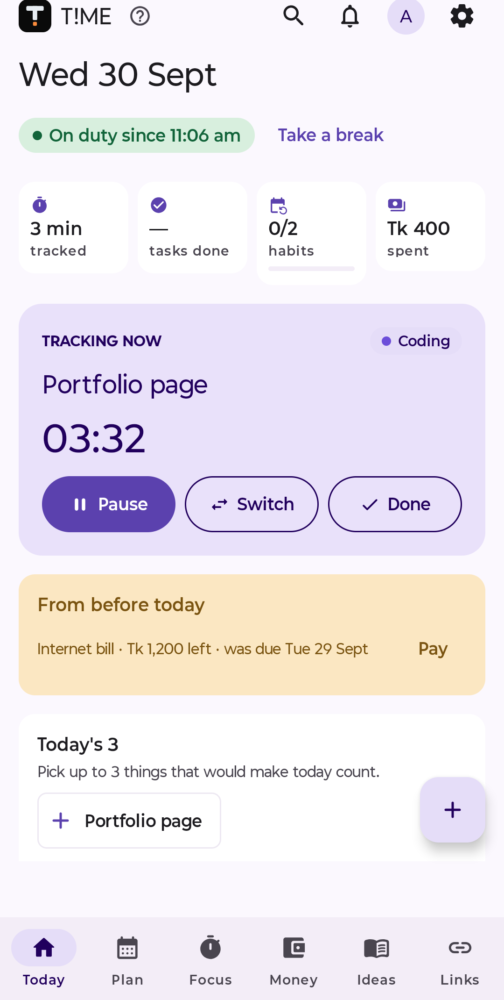
  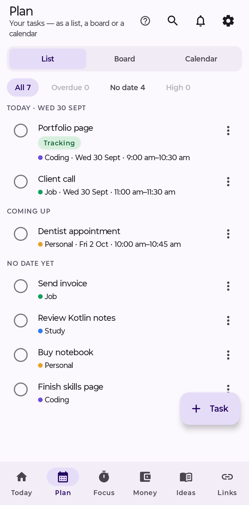
  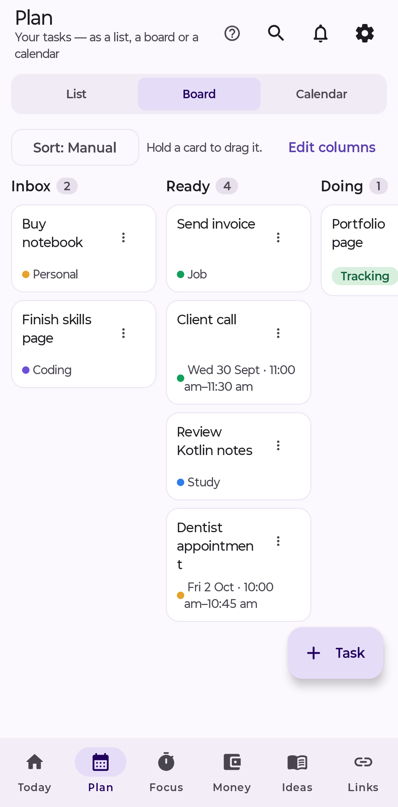
  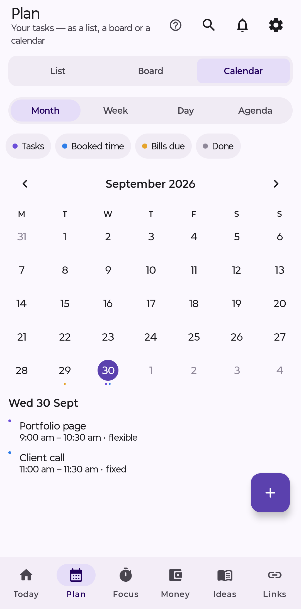
</p>
<p>
  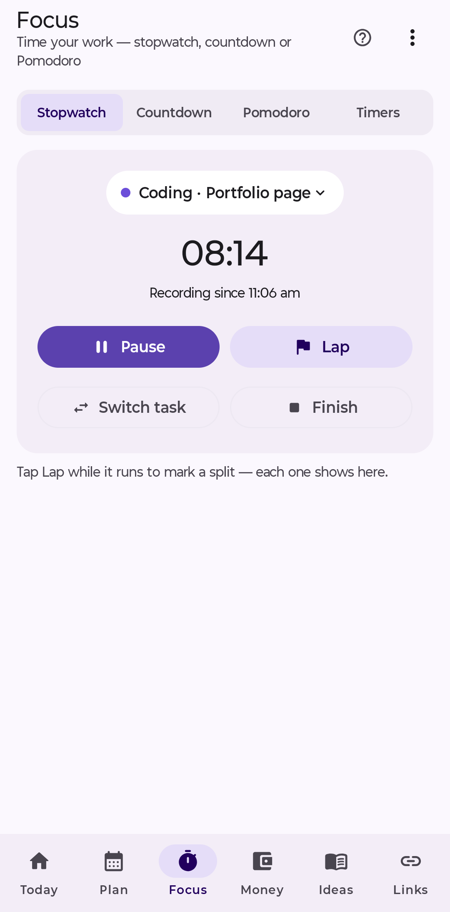
  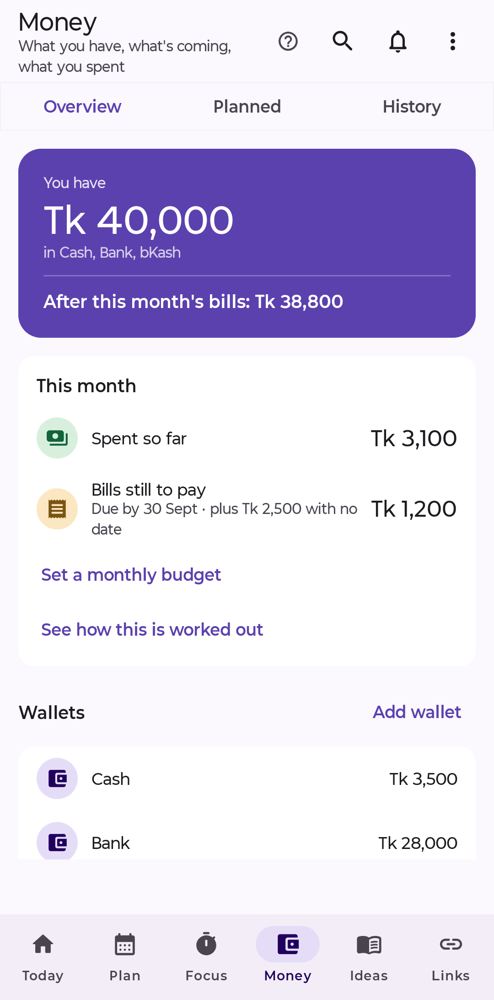
  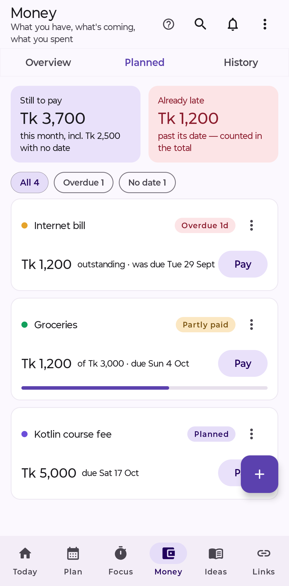
  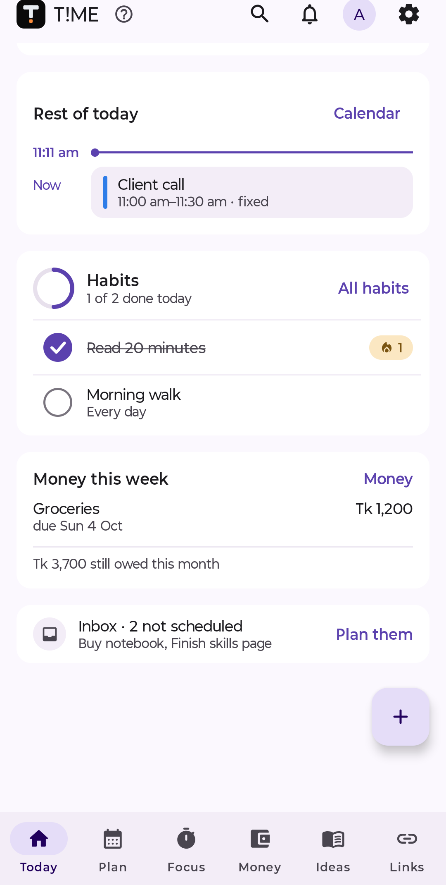
</p>
<p>
  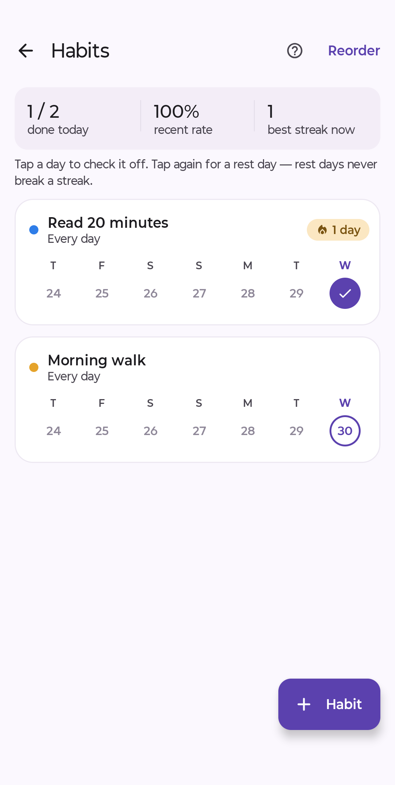
  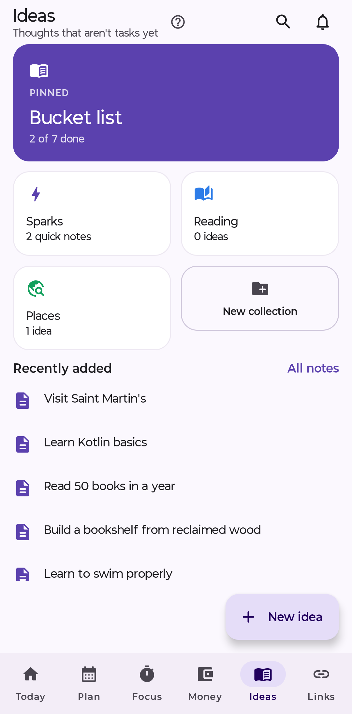
  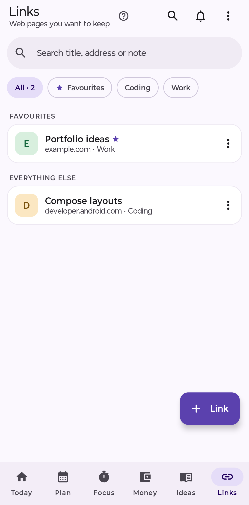
</p>

## Features

### Today
- A live **Now** card: what's running, its time against the estimate, Pause / Switch / Done.
- **Today's 3**: pick up to three things that would make the day count.
- **From before today**: missed tasks and late bills, only when there are some.
- **Rest of today** in time order: booked time, due work, habit reminders, bills.
- Habits to tick in place, money due this week, paused work and the inbox.
- **My workday**: start the day, take breaks (which pause work), end the day, and correct the
  timeline with a reason kept.
- A getting-started checklist and a welcome tour for new users.

### Plan
- Tasks with due dates, estimates, priority, categories, **projects** and **tags**.
- **List**, **Board** (custom columns, soft WIP limits, sort modes, saved filters, drag-and-drop
  with a menu alternative) and **Calendar** (Month, Week, Day, Agenda, with filters).
- **Book time** for tasks or appointments — several blocks per task, split, fixed or flexible.
  Overlaps are always shown and never resolved behind your back.
- **Repeats**: daily, weekly (chosen weekdays), monthly (with a day-31 rule), edit or delete one
  occurrence or the rest of the series.
- Task detail with next steps (subtasks), dependencies ("waits on"), linked bookmarks, money and
  a full history of interruptions.
- **Blocked** and **Paused** states with resume notes; **Reschedule** proposes real free slots
  inside your work hours.
- Archive instead of delete, and **Undo** for deletes and edits.

### Focus
- **One work timer**: stopwatch, countdown or Pomodoro — every mode records real work sessions,
  with or without a task.
- Ongoing notification with a live chronometer and Pause / Resume / Finish.
- Countdown and Pomodoro phases end on time even with the app closed, and never mark a task done
  by themselves.
- **Utility timers**: several named countdowns at once that never count as work.
- **Ring like an alarm** (optional): your own tone, volume and fade-in, vibration patterns, spoken
  alerts, full-screen over the lock screen and hold-to-stop.
- Session history you can edit (the original times and your reason are kept), presets, a break
  reminder, and recovery after a reboot (open sessions are flagged for review, never guessed).

### Money
- **Wallets** (cash, bank, mobile money), transfers with fees, adjustments and archive.
- **Bills to pay**: expected costs with due dates, partial payments, cancelling and repeats.
- **Money in or out** with categories and category icons; **refunds** linked to the original
  expense.
- **Loans and dues**: money lent or borrowed per person, with partial repayments.
- **Savings goals**: set money aside without moving it between wallets.
- A monthly budget and per-category budgets, with alerts at 80 %, when you are heading over and
  when you are over.
- History with search (including by exact amount), filters, a money calendar and Undo.
- Receipt photos or PDFs attached to transactions and carried in backups.
- Exact amounts to the poisha — nothing is ever rounded.

### Habits
- Every day, chosen weekdays, every N days, or N times a week or month.
- **Measurable habits** ("at least 20 pages", "at most 2 cups").
- **Rest days** that never break a streak; notes on any day; timed habits.
- Streaks, recent rates, a 53-week heatmap and a weekday breakdown.
- Reminders with a Done button, plus a home-screen widget.

### Ideas and Links
- Quick notes, your own collections, and a bucket list.
- Saved links with folders, favourites, search, archive and linking to tasks. Share any web page
  to T!ME to save it.
- Notes support light formatting: bold, italic, headings, lists, checklists, links,
  strikethrough, quotes and inline code, with undo and redo.

### Reports and reviews
- Time report: tracked time by category and project, interruptions, and a weekly target.
- Money report: income, spending, planned versus actual, and net worth over time.
- Habit report, a 7-day **workload** check (hours needed versus hours available), and weekly and
  monthly reviews.
- **Me**: plain ratios for focus, delivery, consistency, planning and money review, each with
  its formula and real numbers. There are no points, levels or scores.

### Reminders and notifications
- Reminders for tasks, bookings, bills, loans and habits, each with its own time, surviving
  reboots, time-zone changes and app updates.
- Actions right on the notification: Done, Snooze, Remind me tomorrow.
- Editable quiet hours (reminders are silenced there, never dropped) and a summary of reminders
  missed while the phone was off.
- **The bell**: T!ME's own list of what it notified you about, kept even if you cleared it from the
  shade.

### Privacy and your data
- No account, no internet permission, no analytics or ads.
- Optional **PIN lock** (6–12 digits, stored securely), with fingerprint unlock and hidden
  notification content.
- **Backups**, optionally password-protected (AES-256), and **automatic backups** to a folder you
  choose, keeping the last 7 verified copies.
- Import and export: CSV (transactions), calendar files (.ics) and browser bookmarks (HTML and
  JSON).
- Widgets for Today, Habits, Focus and Money, which show only counts while the lock is on.

### Look and language
- Five accent colours, light and dark, pure black, and wallpaper colours (Android 12+).
- Tablet and landscape layout with a side rail.
- **English and বাংলা**, including Bangla digits and dates; 12- or 24-hour clock, date order,
  a Tk or ৳ label and your choice of week start.
- Accessibility: TalkBack labels, 48 dp touch targets, large text support, adjustable haptics and
  reduced motion.

## Requirements

Android 8.0 (API 26) or later.

## Building

```
./gradlew assembleDebug        # debug build
./gradlew testDebugUnitTest    # unit tests
./gradlew assembleRelease      # release build (unsigned unless keystore.properties exists)
```

Release signing reads an untracked `keystore.properties` at the project root — see
[docs/RELEASING.md](docs/RELEASING.md). No key is ever stored in this repository.

## Documentation

- [User guide](docs/USER_GUIDE.md)
- [Known limitations](docs/KNOWN_LIMITATIONS.md)
- [Changelog](docs/CHANGELOG.md)
- [Third-party notices](docs/THIRD_PARTY_NOTICES.md)

## Translations

Bangla lives in `tools/i18n/bn.tsv` (English ⇥ Bangla). After editing it, run
`python3 tools/i18n/build_catalog.py` to regenerate the app's catalogue.

## License

Copyright (C) 2026 Tafsir Nahian

T!ME is free software: you can redistribute it and/or modify it under the terms of the GNU
General Public License as published by the Free Software Foundation, either version 3 of the
License, or (at your option) any later version. See [LICENSE](LICENSE).
